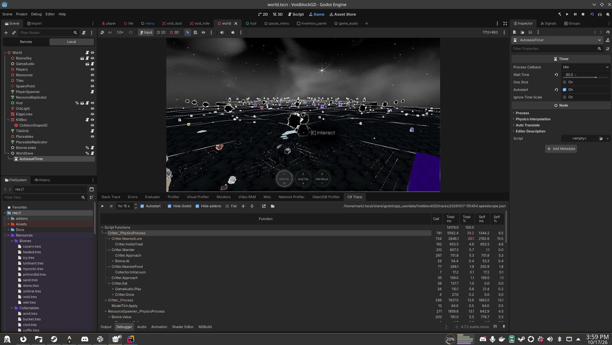

# godot-dotnet-trace

A C# profiler for Godot 4 .NET projects, inside the editor's Debugger panel.



Godot's built-in Profiler shows nothing for C# code.
This addon records a .NET CPU sampling trace of the running game and presents it as a call tree of your script functions, the same way the GDScript profiler does.
It needs no C++ GDExtension and no engine changes.

## How it works

The .NET runtime inside the game exposes an EventPipe diagnostics port.
The addon attaches to it with `Microsoft.Diagnostics.NETCore.Client`, records the sample profiler to a `.nettrace`, and converts it to speedscope JSON with `Microsoft.Diagnostics.Tracing.TraceEvent`, the library behind PerfView.
The call tree, self and total times, and filters are computed from that JSON in the editor.

## Features

- Record, Stop, or record for a fixed number of seconds.
- Autostart on game launch, persisted like the Godot Profiler's own autostart.
- Call tree with Calls, Total ms, Total %, Self ms and Self %, heat-colored by share of time.
- Flat per-function view sorted by self time.
- Hide Godot frames (GodotSharp, System, and the source-generated glue) and hide addon frames, charging their time to the calling script function.
- Collapse All and Expand All.
- Open the trace in https://www.speedscope.app for a flame graph, or open the `.nettrace` in PerfView or Visual Studio on Windows.

## Requirements

- Godot 4.7 .NET.
- .NET SDK 8 or newer.

## Install

1. Copy or symlink `addons/dotnet_trace` into your project's `addons/` folder.
2. Add the packages to your `.csproj`, gated to Debug so exports stay clean:

```xml
<ItemGroup Condition=" '$(Configuration)' == 'Debug' ">
  <PackageReference Include="Microsoft.Diagnostics.NETCore.Client" Version="0.2.510501" />
  <PackageReference Include="Microsoft.Diagnostics.Tracing.TraceEvent" Version="3.1.21" />
</ItemGroup>
```

3. Build, then enable "Dotnet Trace" in Project Settings > Plugins.

## Use

1. Play the game from the editor.
2. Open the Debugger panel and pick the "C# Trace" tab.
3. Press Record, or tick Autostart, optionally with a duration.
4. Press Stop, or stop the game. The trace is converted and the tree fills in.
5. Traces are kept in `user://traces/` as `.nettrace` and `.speedscope.json` pairs.

## Notes

The JIT inlines small methods, so they will not appear as separate frames.
Set `DOTNET_JitNoInline=1` in the environment before launching the editor if you need them.

The addon picks the newest .NET process launched from the same Godot binary as the editor.
If you run two games at once it will attach to the most recent one.

This repository is itself a small Godot project with a CPU-burning test scene, so you can open it in the editor and try the addon directly.

## License

MIT, see LICENSE.md.
